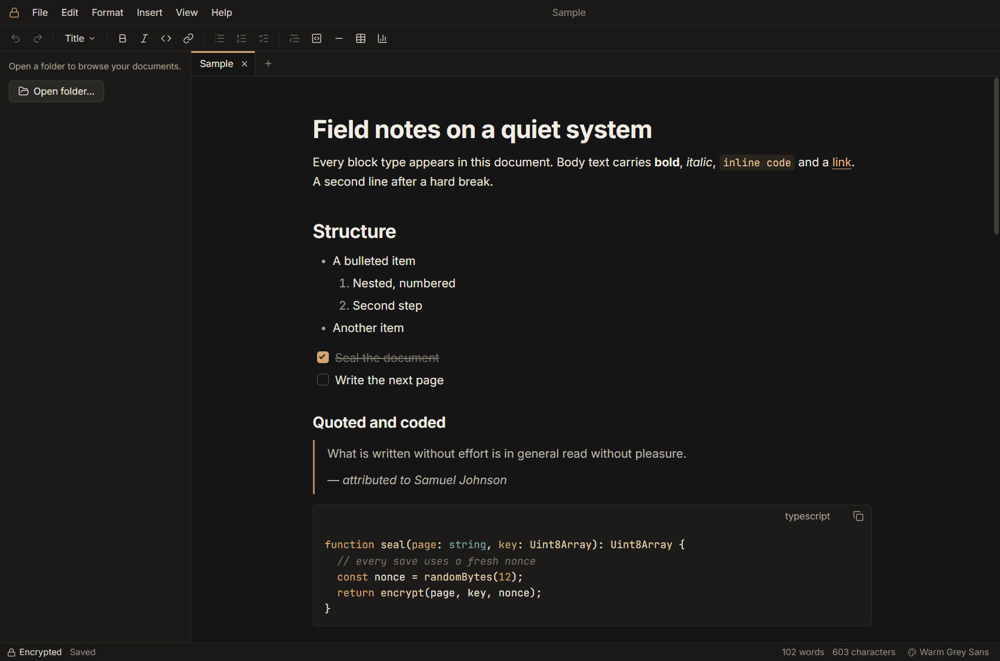
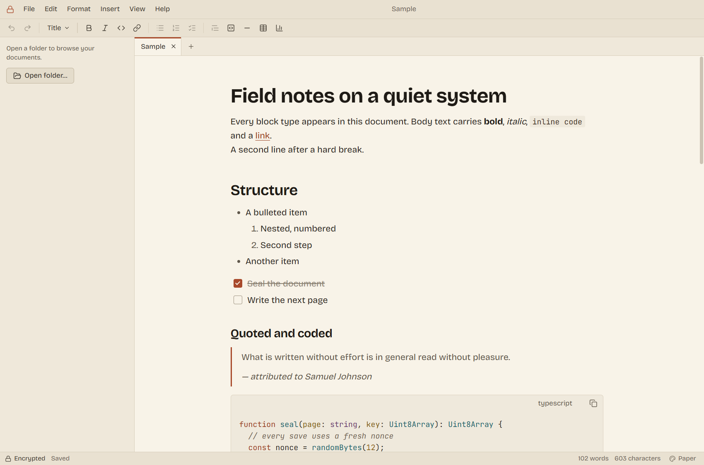
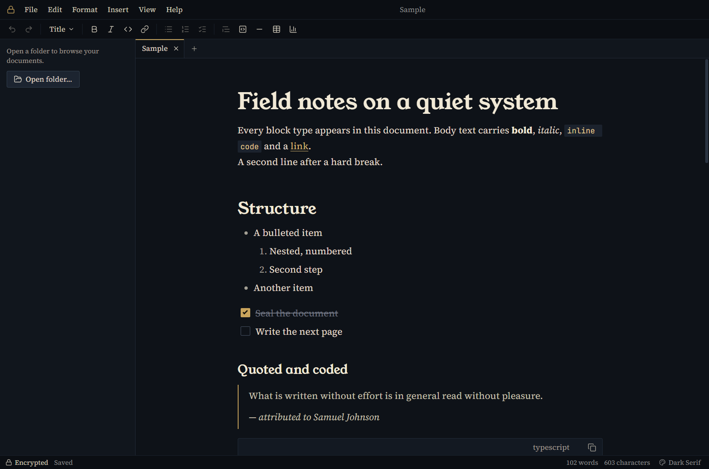
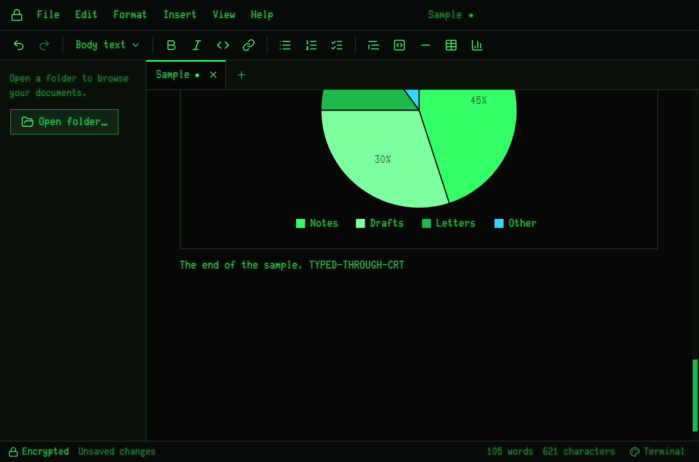
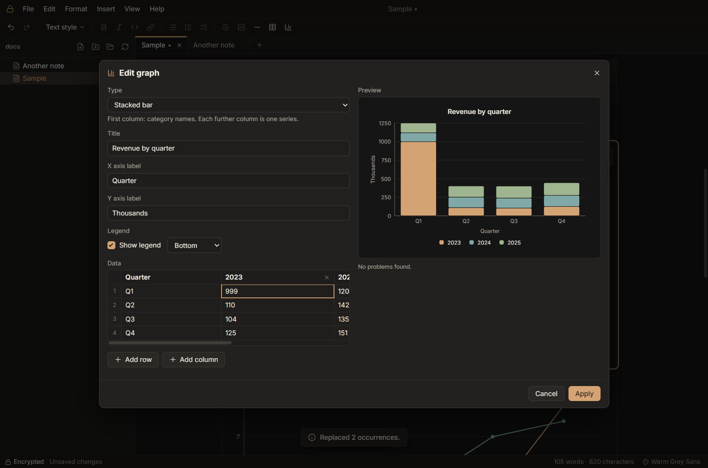

# Sealpage

Sealpage is a text editor for Windows that encrypts every document it saves.
You write in an ordinary-looking editor with headings, lists, tables, code
blocks and graphs. What ends up on disk is a `.slpg` file that can only be
opened with your key. Nothing readable is ever written to disk: no temp files,
no crash-recovery copies, no cache.



## Install

Download the latest `Sealpage-Setup-<version>.exe` from the
[Releases page](../../releases/latest) and run it. You need 64-bit Windows 10 or 11.

The installer is not code-signed, so Windows SmartScreen will warn you the
first time. Click **More info**, then **Run anyway**. It installs for your user
account only, lets you pick the folder, and registers `.slpg` so you can open
documents by double-clicking them.

## Getting started

On first launch Sealpage asks you to choose a passphrase. It needs at least 8
characters, and a long phrase of several words is much better. The key made
from it is stored on your PC, protected by your Windows account, so you are not
asked for the passphrase again.

After that it works like any editor. You never type markup. Formatting comes
from the menu bar, the toolbar, the `/` menu (type `/` on an empty line) or the
keyboard. Press **Ctrl+/** to see every shortcut and rebind any of them.

If you move to a new PC or reinstall Windows, choose **"I already have Sealpage
files"** on the setup screen, enter your passphrase and pick any one of your
files. Sealpage rebuilds the same key from the two.

## Read this before you rely on it

- **There is no recovery.** If you forget the passphrase and lose the key
  stored on your PC (reinstalling Windows does this), your files are gone for
  good. There is no reset and no back door.
- **File names are not encrypted.** Anyone who can see the folder can see what
  your files are called, how big they are and when they changed.
- **Anyone using your logged-in Windows account can open your documents**,
  just by running Sealpage. That is the price of not being asked for the
  passphrase every time. Lock your PC when you walk away, and use BitLocker if
  the machine itself could be stolen.
- **Exports are not encrypted.** Export as Markdown, Export as PDF, Print and
  saving a graph as an image all produce normal readable output. Sealpage warns
  you each time. Anything you copy to the clipboard is plain text too.
- **Unsaved documents exist only in memory.** A document you have never saved
  to a file is lost if the app is closed or killed. Once it has a file, autosave
  keeps the encrypted copy up to date.
- **Windows can still leak memory to disk** through the page file and
  hibernation file. BitLocker on the system drive covers this.
- **Uninstalling keeps your key.** The folder `%APPDATA%\Sealpage` is left
  behind so that reinstalling does not lock you out. Delete it yourself if you
  want the key off the machine.

## Features

- Title, three levels of subheading, body text, bullet, numbered and check
  lists, block quotes, tables, dividers and code blocks with syntax
  highlighting. Inline bold, italic, code and links.
- Graphs built in the app: bar, grouped bar, stacked bar, line, area, pie,
  scatter and histogram. You can paste cells straight from a spreadsheet, and
  export a graph as SVG or PNG.
- Tabs, a folder sidebar, autosave, find and replace, zoom.
- Export to Markdown or PDF, and print. There is no import.
- Changing your passphrase re-encrypts the files you choose, one at a time,
  with a report of what was converted (Settings → Security).
- Four styles, switched with **F8** or in Settings → Style:

| Warm Grey Sans | Paper |
| --- | --- |
|  |  |
| **Dark Serif** | **Terminal** |
|  |  |

The graph editor:



## How the encryption works

Sealpage invents no cryptography. Your passphrase is turned into a master key
with Argon2id (256 MiB of memory, 3 passes). Every save gets its own key,
derived with HKDF-SHA-256, and is encrypted with AES-256-GCM. The whole file is
authenticated, so a file that has been changed, cut short or opened with the
wrong key simply fails to open. The master key is stored wrapped by Windows
DPAPI, and the passphrase itself is never stored. The app makes no network
requests.

The file format is documented byte for byte in [docs/FORMAT.md](docs/FORMAT.md),
in enough detail to write your own reader.

## Building from source

You need Node.js 22 or newer on 64-bit Windows.

```bash
npm install
npm start        # build and run in development mode
npm test         # type check, unit tests, end-to-end and no-trace tests
npm run dist     # build the installer into release/
```

The source is laid out as `src/main` (Electron main process: crypto, key
store, file writes), `src/preload` (the bridge to the sandboxed window),
`src/renderer` (the editor and UI) and `src/shared` (document model, file
format, graphs, Markdown export).

## Licence and credits

Sealpage is released under the [MIT License](LICENSE).

Built with Electron, ProseMirror, highlight.js and hash-wasm. Icons are from
[Lucide](https://lucide.dev).

The bundled fonts are Inter, Bricolage Grotesque, Young Serif, Source Serif 4
and JetBrains Mono (all SIL Open Font License 1.1) and Glass TTY VT220 by
Viacheslav Slavinsky (public domain). Each font's licence file sits next to it
in `assets/fonts/`.
